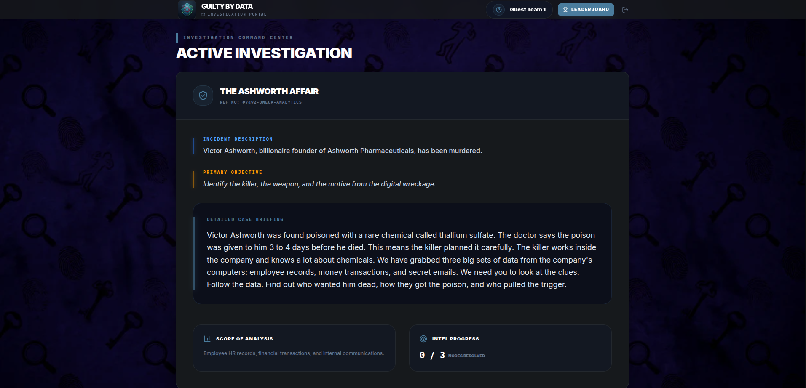
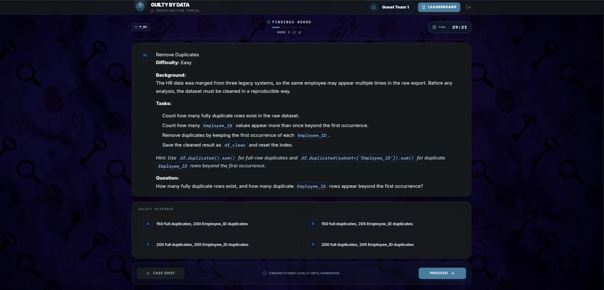
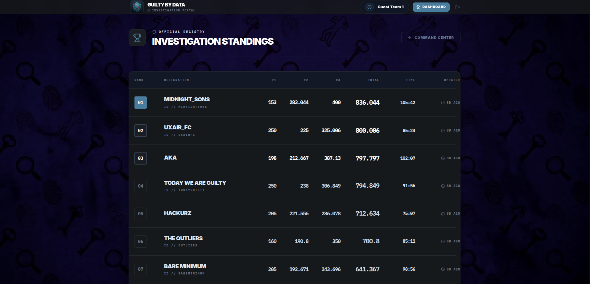
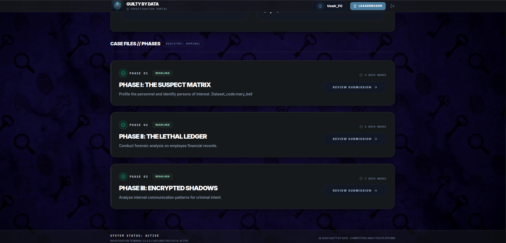

<div align="center">

# 🕵️ Guilty by Data

### Investigation Platform for Developers Day' 26

Guilty by Data is a real-time, multi-round competition web app built for the
**Developers Day' 26 - Guilty By Data Competition**. Teams investigate a case,
answer MCQ and blank-style questions, submit once per round, and track rankings
through a live leaderboard.


[Preview](#platform-preview) | [Features](#features) | [Flow](#how-it-works) | [Setup](#setup) | [Scripts](#scripts) | [Credits](#credits)

</div>

---

## Overview

The project was made for an on-site data investigation competition where
participants solve a case in phases. Admins can manage rounds, questions,
options, timers, submissions, and leaderboard flow. Participants get a focused
round-based interface with saved draft progress, timed submissions, and realtime
score updates.

---

## 📸 Platform Preview

<div align="center">

### Investigation Brief



<sub>The case briefing screen where teams understand the investigation objective.</sub>

<br/><br/>

### Question Flow



<sub>Timed question flow with MCQ answers, local draft progress, and controlled submission.</sub>

<br/><br/>

### Live Leaderboard



<sub>Realtime standings ranked by score and completion time.</sub>

<br/><br/>

### Round Dashboard



<sub>Competition phases with round status, review flow, and dataset node counts.</sub>

</div>

---

## ✨ Features

- Team login and participant dashboard
- Admin controls for rounds, questions, options, timers, and content visibility
- MCQ and blank-question scoring
- One-time, server-authoritative round submissions through Vercel API routes
- Hidden submission grace window after the visible timer ends
- Realtime leaderboard and submission updates with Supabase
- Persisted participant draft progress
- Supabase migrations, policies, RPCs, and security boundaries included

---

## How It Works

1. Admins create and control the competition rounds from the admin panel.
2. Teams log in and move through the case phases one round at a time.
3. Answers are saved locally while participants work through a round.
4. Final submissions go through server API routes, not directly from the browser.
5. Supabase stores submissions, calculates scores, and updates the leaderboard in realtime.

This keeps the participant experience simple while keeping scoring and privileged
actions on the server side.

---

## Tech Stack

| Area | Technology |
| --- | --- |
| Frontend | React 19, TypeScript, Vite |
| Styling | Tailwind CSS v4 |
| State | Zustand |
| API | Vercel-style Node functions in `api/` |
| Database/Auth/Realtime | Supabase |
| Package Manager | npm |

## Project Structure

```text
api/                  Server API routes for submissions and admin actions
public/               Logos, backgrounds, and README screenshots
scripts/              Team seeding, cleanup, and round-content scripts
src/                  React app, pages, components, store, and helpers
supabase/migrations/  Database schema, policies, functions, and realtime setup
```

---

## 🚀 Setup

### Prerequisites

- Node.js 20+ recommended
- npm
- A Supabase project
- A Vercel account if you want to deploy it

### 1. Install Dependencie

```bash
npm install
```

### 2. Add Environment Variables

Copy the example file and fill it with your own Supabase values:

```bash
cp .env.example .env.local
```

Required variables:

```env
VITE_SUPABASE_URL=https://your-project-id.supabase.co
VITE_SUPABASE_ANON_KEY=your-anon-key-here

SUPABASE_URL=https://your-project-id.supabase.co
SUPABASE_SERVICE_ROLE_KEY=your-service-role-key-here
```

Important:

- `VITE_SUPABASE_URL` and `VITE_SUPABASE_ANON_KEY` are used by the browser.
- `SUPABASE_URL` and `SUPABASE_SERVICE_ROLE_KEY` are used only by server routes and scripts.
- Never expose `SUPABASE_SERVICE_ROLE_KEY` in frontend code or public commits.
- `.env.local` is ignored by git. Keep it local.

### 3. Set Up Supabase

Apply the SQL migrations from `supabase/migrations/` in timestamp order. For a
fresh Supabase project, apply all migrations. For an existing project, apply only
the migrations that have not already been applied.

### 4. Run Locally

```bash
npm run dev
```

### 5. Build

```bash
npm run build
```

---

## Deployment

For Vercel deployment:

1. Add these four environment variables in Vercel Project Settings:
   `VITE_SUPABASE_URL`, `VITE_SUPABASE_ANON_KEY`, `SUPABASE_URL`,
   `SUPABASE_SERVICE_ROLE_KEY`.
2. Make sure the Supabase migrations are applied before testing production.
3. Deploy the repo on Vercel.
4. Smoke test team login, admin round controls, participant submission, blank
   scoring, MCQ scoring, and leaderboard updates.

---

## Scripts

| Command | Purpose |
| --- | --- |
| `npm run dev` | Start the local Vite development server. |
| `npm run build` | Type-check and create the production build. |
| `npm run preview` | Preview the production build locally. |
| `npm run lint` | Run ESLint checks. |
| `npm run test` | Run lint and build together. |
| `npm run update:rounds` | Push the bundled round titles, objectives, and case briefs to Supabase. |
| `npm run seed:teams` | Read `scripts/teams.csv` and create/update team auth users and `teams` rows. |
| `npm run cleanup:teams` | Interactively remove seeded teams and their related competition data. |

### Team CSV Format

`npm run seed:teams` reads `scripts/teams.csv`.

```csv
full_name,username,password
Sample Team Alpha,teamalpha,ChangeMe123!
Sample Team Beta,teambeta,ChangeMe456!
```

Rules:

- `full_name`, `username`, and `password` are required.
- Usernames should use letters, numbers, `_`, or `-`.
- Passwords must be at least 6 characters.
- Replace the sample rows with your real competition teams before seeding.
- Seeding, cleanup, and round updates require `SUPABASE_SERVICE_ROLE_KEY` in `.env.local`.

---

## 🤝 Credits

Built by
<a href="https://github.com/AbdulRafayMughal86/"><strong>Abdul Rafay Mughal</strong></a>,
<a href="https://github.com/codexbegin14/"><strong>Muhammad Awais</strong></a>, and
<a href="https://github.com/sushisajid/"><strong>Usaid Sajid</strong></a>.

<div align="center">

<h3>Thanks for checking this out! 👋</h3>

<p>
  <strong><em>Follow the clues. Trust the data. Find the guilty.</em></strong>
</p>

<p>
  <sub>Built for Developers Day' 26 - Guilty By Data Competition.</sub>
</p>

</div>
